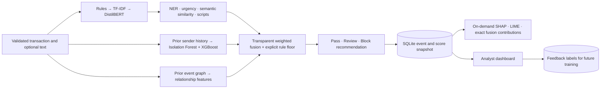

# Architecture and evidence contract

## Invariants

- A score is a risk index, not a calibrated probability of monetary loss.
- A recommendation never executes a transfer or actually blocks a bank account.
- Labels, scenarios, and future transactions never enter inference features.
- Historical model flags are observations, never confirmed fraud labels.
- Record explanations against the original feature and score snapshot. Do not
  recompute history later and pretend the new explanation is the original one.
- Preserve transaction IDs: retries return the same result; conflicting payloads
  are rejected. Process a batch chronologically and commit it atomically.
- Shared IP/device evidence is counted only across explicitly distinct relationship
  groups. Shared infrastructure can be legitimate and needs analyst interpretation.
- Full model artifacts are required. Missing models fail startup rather than
  silently substituting an untrained transformer or pretending a heuristic is ML.
- NER and script detection are contextual evidence and do not establish fraud.

## Operating scope

This is a single-process, local research demo. Real deployments need authenticated
analyst roles, encrypted PII, retention controls, adjudicated labels, distributed
feature storage, drift monitoring, multilingual validation, model governance, and
capacity tests. Those are deployment work, not evidence delivered by synthetic F1.
