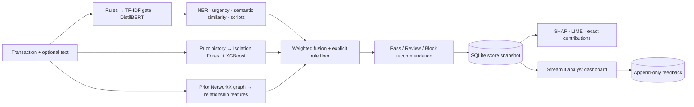
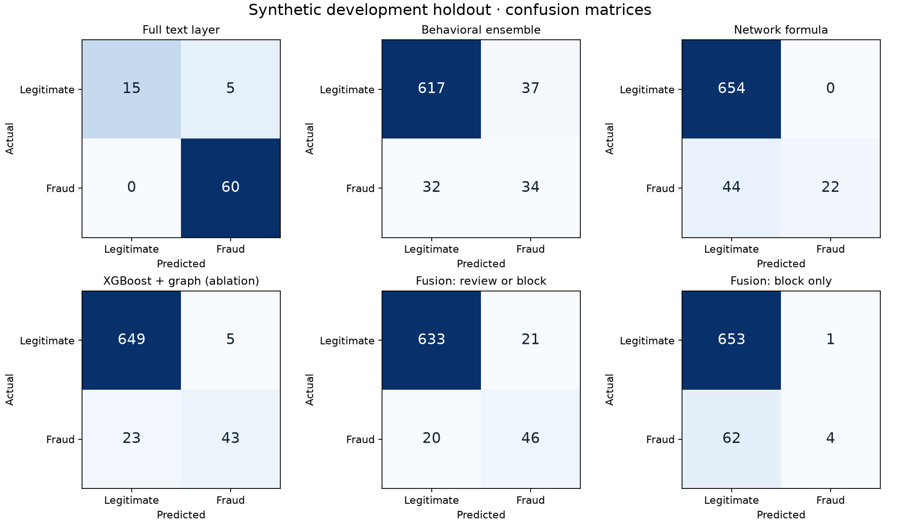

# Fraud Signals

An explainable financial fraud detection demo combining **fine-tuned DistilBERT, transaction history, a relationship graph, and explicit rules**. Includes all five layers, trained artifacts, reproducible experiments, FastAPI, SQLite feedback, and a Streamlit analyst dashboard.

**Research demo, not a bank deployment.** The supplied dataset is original synthetic data, not downloaded PaySim. Decisions are recommendations; no banking system is connected. Risk scores are not calibrated fraud probabilities. See [evaluation results](reports/EVALUATION.md) and [data provenance](data/provenance.json).

## First time? Test the app without coding

Open the dashboard and start on **Try a demo**:

1. Click **Try normal payment**. A result window should show **Low risk**.
2. Close it, then click **Try OTP scam**. Expect **High risk, 90/100**. The payment amount is unchanged; the message asks for a secret code.
3. Close the result and click **Run system check** below the examples. The app checks the service, both example decisions, saved records and a detailed explanation. All five checks should pass.
4. Try **Check a payment** to change the amount or wording. **Recent checks** contains the saved results and optional feedback.

A passing system check verifies those app functions, not the model's accuracy on every real-world scam. It creates two synthetic records. The normal and OTP demos also save real checks through the API; their displayed results are not mocked.

For CSVs, open **Upload a CSV**, download the example and upload it again. The default **Treat these as new demo payments** option gives rows new IDs and current timestamps while retaining their payment details and row order. Your original file remains unchanged. Turn it off only when you want original IDs and event times preserved.

The **How it works** page explains the three risk levels and the difference between a risk index and a probability. Threshold controls, model internals and connection settings remain available behind advanced controls.

To repeat the guided UI checks automatically while the API is running: `python scripts/test_dashboard.py`.

## Streamlit Community Cloud

Deploy repository `iayamin6/Financial-Fraud-Detector`, branch `main`, entrypoint `streamlit_app.py`, with **Python 3.11** in Advanced settings. Dependencies are in `requirements.txt` and `packages.txt`; Git LFS supplies the trained weights.

To run the same single-process version locally after installing dependencies:

```bash
streamlit run streamlit_app.py
```

The cloud entrypoint runs all five scoring layers directly, so it needs no separate API server. Model objects are shared to conserve memory; each browser session has its own temporary SQLite history and feedback. Refreshing/disconnecting or restarting the app may clear this demo history. Use synthetic examples only. First startup loads the neural models and can take longer than subsequent checks.

For a quick test, open **Try a demo → Run system check**. All five checks should pass. Upload `data/fraud_test_50_unique.csv` to try 50 varied synthetic payments.

## Run the supplied trained system

Use Python 3.11 or 3.12. From this project directory:

```bash
python3.11 -m venv .venv
source .venv/bin/activate
pip install -e '.[dev]'
python -m spacy download en_core_web_sm
python scripts/run_api.py
```

In a second terminal, activate the same environment:

```bash
python scripts/seed_demo.py
python scripts/run_dashboard.py
```

- Dashboard: [http://127.0.0.1:8501](http://127.0.0.1:8501)
- Interactive API docs: [http://127.0.0.1:8765/docs](http://127.0.0.1:8765/docs)
- Readiness: [http://127.0.0.1:8765/health](http://127.0.0.1:8765/health)

For this delivered workspace, a tested environment already exists at `../../work/.venv`; use `source ../../work/.venv/bin/activate` to avoid reinstalling. The local API and dashboard were left running for inspection. `Ctrl+C` stops foreground launches.

The first install needs Internet access. Supplied BERT and sentence-embedding artifacts are loaded locally at API startup; inference makes no model-download requests. Missing artifacts or the spaCy package cause an explicit startup failure. `requirements-lock.txt` records the tested environment; use `pip install -r requirements-lock.txt` followed by `pip install -e . --no-deps` to reproduce its versions. Transformer and sentence-transformer upstream licenses remain applicable to their downloaded artifacts.

On macOS, XGBoost may require the system OpenMP runtime (`brew install libomp`). The launch scripts set conservative native thread defaults because unrestricted mixed numerical libraries crashed during initial integration. Do not remove these limits without retesting.

## Architecture



| Layer | Implementation | Explanation |
|---|---|---|
| Text | Regex first; TF-IDF + logistic regression gates DistilBERT; spaCy NER; MiniLM cosine similarity; Unicode script detection | Rule spans, routed scores, matched example, entity context; LIME on full routed text score |
| Behavior | Prior sender median, hourly velocity count/sum, new payee, round amounts, time encoding, account-age/size, device/country changes; XGBoost + Isolation Forest | SHAP on the actual combined behavioral function |
| Network | Rolling directed graph; recipient prior flags, fan-in/out, rapid forwarding, shared infrastructure across distinct relationship groups | Exact named formula components; separate XGBoost graph-feature ablation |
| Fusion | 0.35 text + 0.35 behavior + 0.20 network + 0.10 rules; high-confidence rule floor | Exact weighted contributions and override delta |
| Feedback | Analyst correction tied to original transaction and recommendation | Append-only labels classified as false positive/negative or confirmed |

See [ARCHITECTURE.md](ARCHITECTURE.md) for invariants. Main modules live in `fraud/`; HTTP transport is in `api/`; the dashboard uses the API locally or an embedded transport on Streamlit Cloud, and never trains models.

Text classes are `legitimate`, `otp_scam`, `phishing`, and `impersonation`. The BERT binary scam score is `1 − P(legitimate)`. A direct credential request can skip transformer and embedding inference. Other text follows the baseline gate, then optionally BERT; semantic and urgency evidence adjust the model score. NER and script mixing are contextual evidence, not independent fraud accusations. The initial language model and NER model are English; script detection alone does not provide multilingual classification.

Behavioral XGBoost uses training-only scaling and SMOTE. Isolation Forest fits legitimate training examples; its anomaly score is normalized using training quantiles. SMOTE interpolates the continuous feature representation, including indicators, so SMOTENC is a sensible external-data upgrade. The network layer uses **prior rule flags, not ground-truth labels**, as recipient history. Fan-out is extracted and used in the diagnostic tabular ablation; the standalone network formula emphasizes shared infrastructure and fan-in/forwarding.

Missing text contributes zero with fixed fusion weights and is explicitly marked unavailable. This avoids pretending that missing text was classified as legitimate, but can reduce sensitivity. Cold-start accounts use configured defaults. History and graph features are strictly earlier than the current event; equal-timestamp events cannot influence each other.

## Rebuild in the requested sequence

Stop the API before replacing artifacts. Reuse the environment above. Check each stage’s JSON report before continuing:

```bash
# 1–2. Structure is supplied; generate linked original synthetic datasets.
python -m fraud.data

# 3. Train baseline, then fine-tune actual pretrained DistilBERT and evaluate NLP.
HF_HUB_DISABLE_XET=1 python scripts/train_text.py
python -m pytest tests/test_text_rules.py tests/test_text_model.py tests/test_data.py -q

# 4. Train and evaluate behavioral models.
python scripts/train_behavior.py
python -m pytest tests/test_behavior.py -q

# 5. Compute graph features, evaluate standalone scores and tabular ablation.
python scripts/train_network.py
python -m pytest tests/test_network.py -q

# 6. Evaluate fusion, select policy from validation only, evaluate selected policy.
python scripts/evaluate_fusion.py
python scripts/calibrate_policy.py
python scripts/evaluate_fusion.py

# 7. Verify real SHAP/LIME execution and reconstruction.
python scripts/verify_explanations.py

# 8. Test API and persistence, then start the service.
python -m pytest -q
python scripts/run_api.py

# 9. In another terminal: seed synthetic demo and launch dashboard.
python scripts/seed_demo.py
python scripts/run_dashboard.py

# 10. With API running, benchmark and regenerate report summary.
python scripts/benchmark.py
python scripts/summarize_reports.py
```

`HF_HUB_DISABLE_XET=1` uses Hugging Face's standard HTTP path; it resolved a stalled checkpoint download in this environment. BERT training used Apple MPS when available; inference uses CPU. Set `nlp.base_model` in `config.yaml` to a compatible full BERT checkpoint and rerun text training to swap models. The runtime currently supports BERT-family sequence classifiers through Hugging Face auto classes. Numerical reproducibility across devices is not guaranteed, even with fixed seeds.

`/notebooks` is reserved for exploration; the experiments are scripts so evaluation does not depend on hidden notebook state. Synthetic datasets and trained models are included. Large `.safetensors` weights use Git LFS; run `git lfs install` before cloning, or `git lfs pull` after cloning. Runtime SQLite databases, secrets, and logs are excluded from Git.

## Evaluation and limitations

The dataset contains 3,600 chronological transactions (2,160/720/720 train/validation/test) and 736 text examples. Text splits hold out whole templates, including all their variants. There are only 16 unique templates in each text validation/test partition, so the 80 text rows per partition are not 80 independent observations. Fraud prevalence and scenario construction are synthetic. No claim of real-world SMS, PaySim, or banking performance is made.

Every score-producing layer reports precision, recall, F1, ROC-AUC, PR-AUC, and a confusion matrix. Text positives are the three scam classes. Transaction positives are **any simulated fraud**, including types a given isolated layer cannot identify. Final fusion counts review or block as positive; block-only performance is also reported. No accuracy-only evaluation is used.

Review threshold **0.400** was selected using validation F2 to favor recall; block threshold **0.575** satisfies the configured validation precision criterion. Earlier generic and F1-selected policies are retained in separate reports. Because test results were observed during development, this is a **development holdout**, not a pristine external benchmark. Template differences cause large validation/test shifts, particularly for rule activations. Block recommendations need stronger external validation.

The final transaction test set contains 66 fraud cases and 654 legitimate cases. Fusion found 46 fraud cases with 21 false positives (precision 0.687, recall 0.697, F1 0.692). Social-only recall is about 45%; this remains a material limitation. The graph ablation raised XGBoost F1 by 0.358. Full tables and confusion matrices are in [EVALUATION.md](reports/EVALUATION.md).



Local warmed inference averaged about 12.6 ms; HTTP p95 was about 28.6 ms over 32 sequential requests. This covers four text routes and a small demo history. Graph reconstruction and SQLite history loading grow with stored data; this is not a scalable online feature store or throughput guarantee. On-demand explanations are deliberately outside the scoring path.

## API contract

| Endpoint | Request | Response |
|---|---|---|
| `POST /score` | Transaction JSON | Score, decision, sub-scores, evidence, latency and model version |
| `POST /score/batch` | JSON list or `{ "transactions": [...] }` | Results in original input order; processing is chronological |
| `POST /score/batch/csv` | Multipart file named `file` | Same batch response |
| `POST /explain/{transaction_id}` | No body | Cached SHAP/LIME and exact score accounting |
| `POST /feedback` | ID, binary correct label, optional comment | Recorded adjudication category |
| `GET /transactions?limit=100` | None | Recent stored score snapshots |
| `GET /metrics` | None | Persisted unique-score count and mean per-layer latency |
| `GET /health`, `GET /policy` | None | Readiness/model version and saved policy |

Example against the running API (use a current UTC timestamp for a new event):

```python
from datetime import datetime, timezone
from uuid import uuid4
import httpx

transaction = {
    "transaction_id": str(uuid4()),
    "sender_id": "customer-7",
    "recipient_id": "new-agent",
    "amount": 500,
    "timestamp": datetime.now(timezone.utc).isoformat(),
    "account_age_days": 365,
    "device_id": "phone-7",
    "relationship_group": "household-7",
    "text": "Send your OTP to our bank agent immediately."
}
r = httpx.post("http://127.0.0.1:8765/score", json=transaction)
r.raise_for_status()
print(r.json())
```

Required CSV/JSON fields are `transaction_id`, `sender_id`, `recipient_id`, positive finite `amount`, timezone-aware `timestamp`, and nonnegative `account_age_days`. Optional fields: `device_id`, `ip_address`, `relationship_group`, `country`, `text`. Use one normalized currency. Device/IP/group context must come from trusted bank telemetry in a real integration; client claims are not verified here. Empty optional CSV cells become null. Do not upload training labels or scenario/split columns.

Requests and responses use Pydantic schemas. Unknown fields, naive dates, overlong text, nonfinite amounts, malformed CSVs, duplicate headers and invalid labels are rejected. Batches are limited to 250 rows / 2 MB by default. Duplicate IDs within a batch return 409. A repeat ID with the identical canonical payload returns the original score; changed payloads return 409. A scoring failure rolls back the entire batch.

The API requires nondecreasing event time across new requests and sorts each batch internally. Historical replay requires a fresh database path in a copied config. Set `FRAUD_CONFIG=/absolute/path/to/config.yaml`; relative paths resolve against that file. Rejected historical events are not silently scored against future history.

SHAP explains the combined behavioral function in risk-score units, using 16 saved training background rows and a seeded permutation cycle. LIME perturbs text through the complete routed scoring function; its local R² is exposed and can be poor. Rule short-circuits receive exact regex evidence instead of an irrelevant transformer explanation. Fusion displays its exact weighted sum and rule override. These are model explanations, not causal proof.

Explanations use saved input/features, not recomputed later history. Model/config/source fingerprints prevent explaining an old score with new artifacts; an already cached explanation remains retrievable. Keep original model versions if you need to regenerate historical explanations. Feedback appends revisions and never silently retrains.

## Configuration and deployment boundary

`config.yaml` contains paths, thresholds, model names, weights, rules, language-mixing allowances, history windows, batch limits, and service ports. The dashboard threshold sliders are a local preview; they do not mutate API policy or past decisions. Restart the API to apply config changes.

The service binds to loopback, runs one worker, serializes model scoring, and uses SQLite transactions. It has no authentication, encryption-at-rest, production retention policy, rate limiting, currency conversion, real geolocation resolution, drift monitoring, or bank enforcement connector. Use synthetic data for this local demo. A bank integration needs trusted feature ingestion, appropriate access controls and privacy handling, historical artifact retention, point-in-time labels, external multilingual evaluation and load testing.

A v2 stacked model should be trained on **out-of-fold/time-forward sub-scores**, with a separate calibration set, not on in-sample base-model predictions. The current weighted implementation is complete and deliberately transparent; a GNN and automatic retraining are not implemented.

## Reference documentation

Implementation references: [Hugging Face Transformers](https://huggingface.co/docs/transformers/en/main_classes/trainer), [spaCy models](https://spacy.io/usage/models), [Sentence Transformers](https://www.sbert.net/docs/package_reference/sentence_transformer/SentenceTransformer.html), [imbalanced-learn leakage guidance](https://imbalanced-learn.org/dev/common_pitfalls.html), and [SHAP](https://shap.readthedocs.io/en/latest/generated/shap.TreeExplainer.html). Training uses an explicit PyTorch loop rather than Trainer. Behavioral explanations use SHAP's permutation explainer to cover both component models and the score transformation.
